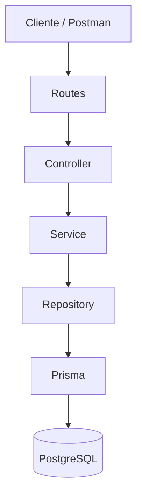

# Arquitetura da API da Biblioteca

## 1. Objetivo

O objetivo desta refatoração foi reorganizar a API da Biblioteca Escolar desenvolvida anteriormente, deixando o código mais organizado e separando melhor as responsabilidades de cada parte da aplicação.

A ideia foi manter o funcionamento da API, mas melhorar a estrutura do projeto para facilitar a manutenção e futuras alterações.

---

## 2. Arquitetura em camadas

A aplicação foi organizada em camadas, onde cada uma possui uma responsabilidade específica.



O fluxo principal da aplicação funciona da seguinte forma:

**Routes → Controller → Service → Repository → Prisma → PostgreSQL**

### Routes

As rotas recebem as requisições HTTP e direcionam cada requisição para o Controller correspondente.

Exemplos:

* `GET /livros`
* `POST /livros`
* `GET /emprestimos`
* `POST /emprestimos`
* `PATCH /emprestimos/:id/devolver`

### Controller

O Controller é responsável por receber a requisição, pegar os dados necessários e chamar o Service.

Ele também define o status HTTP e a resposta enviada para o cliente.

O acesso direto ao banco de dados não fica no Controller.

### Service

O Service representa a camada responsável pela lógica da aplicação.

Ele recebe as informações do Controller e utiliza o Repository para realizar as operações necessárias.

Também é nessa camada que ficam algumas validações e regras relacionadas ao funcionamento da aplicação.

### Repository

O Repository concentra o acesso ao banco de dados.

As consultas realizadas através do Prisma ficam nessa camada.

Dessa forma, o Controller e o Service não precisam conhecer os detalhes de como os dados são buscados ou alterados no PostgreSQL.

### Prisma

O Prisma funciona como ORM da aplicação e faz a comunicação entre o código JavaScript e o banco de dados PostgreSQL.

---

## 3. Repository Pattern

O padrão Repository foi utilizado para separar o acesso aos dados da lógica das outras camadas.

No projeto foram utilizados:

```text
data/livros.repository.js
data/emprestimos.repository.js
```

Esses arquivos são responsáveis pelas operações relacionadas ao banco de dados.

### Problema que o padrão resolve

Sem o Repository, as consultas ao banco poderiam ficar espalhadas pelos Controllers e Services.

Isso deixaria o código mais difícil de entender, testar e modificar.

Com o Repository, o acesso aos dados fica concentrado em uma camada específica.

### O que aconteceria sem esse padrão?

Os Controllers poderiam precisar conhecer diretamente o Prisma e as consultas utilizadas no banco.

Isso aumentaria o acoplamento entre as partes da aplicação e dificultaria uma futura troca ou alteração da tecnologia de persistência.

---

## 4. Dependency Injection

A Injeção de Dependência foi utilizada para evitar que os componentes precisem criar suas próprias dependências.

No projeto, as dependências são criadas no `app.js` e passadas para as outras camadas.

Exemplo:

```js
const livrosRepository = criarLivrosRepository({
    prisma
});

const livrosService = criarLivrosService({
    livrosRepository
});

const livrosController = criarLivrosController({
    livrosService
});
```

Dessa forma, o Service recebe o Repository de que precisa, e o Controller recebe o Service.

### Problema que o padrão resolve

Sem a Injeção de Dependência, cada parte poderia criar diretamente suas próprias dependências.

Isso aumentaria o acoplamento e dificultaria a troca de implementações e a realização de testes.

### O que aconteceria sem esse padrão?

O Service poderia, por exemplo, importar diretamente o Prisma ou criar diretamente um Repository.

Nesse caso, ficaria mais difícil substituir o Repository por outra implementação.

Com a Injeção de Dependência, cada componente recebe aquilo que precisa para funcionar.

---

## 5. Factory Pattern

O Factory Pattern foi utilizado através das funções `criar...` presentes nas diferentes camadas da aplicação.

Exemplos:

```text
criarLivrosRepository()
criarLivrosService()
criarLivrosController()
criarLivrosRoutes()

criarEmprestimosRepository()
criarEmprestimosService()
criarEmprestimosController()
criarEmprestimosRoutes()
```

Essas funções são responsáveis por criar os componentes e receber suas dependências.

Por exemplo:

```js
const livrosService = criarLivrosService({
    livrosRepository
});
```

### Problema que o padrão resolve

A criação dos componentes fica organizada e separada da utilização deles.

O `app.js` consegue montar a aplicação passando as dependências necessárias para cada componente.

### O que aconteceria sem esse padrão?

A criação dos componentes e suas dependências poderia ficar espalhada pelo projeto.

Isso deixaria a inicialização da aplicação mais confusa e aumentaria o acoplamento entre os componentes.

Com as funções de criação, a montagem de cada parte fica mais clara e organizada.

---

## 6. Separação de responsabilidades

A arquitetura foi organizada da seguinte maneira:

| Camada     | Responsabilidade                                 |
| ---------- | ------------------------------------------------ |
| Routes     | Definir os endpoints e encaminhar as requisições |
| Controller | Receber requisições e enviar respostas HTTP      |
| Service    | Executar a lógica da aplicação e validações      |
| Repository | Realizar o acesso aos dados                      |
| Prisma     | Fazer a comunicação com o banco                  |
| PostgreSQL | Armazenar os dados                               |

Essa separação evita que uma única parte da aplicação fique responsável por muitas funções diferentes.

---

## 7. Exemplo do fluxo de criação de um empréstimo

Quando um empréstimo é criado, o fluxo segue estas etapas:

```text
POST /emprestimos
        ↓
Routes
        ↓
Controller
        ↓
Service
        ↓
Repository
        ↓
Prisma
        ↓
PostgreSQL
```

O Controller recebe os dados da requisição e chama o Service.

O Service realiza as validações necessárias e solicita ao Repository a operação.

O Repository utiliza o Prisma para consultar e alterar os dados no banco.

---

## 8. Exemplo do fluxo de devolução

Na devolução de um livro, o fluxo também segue a separação definida na arquitetura:

```text
PATCH /emprestimos/:id/devolver
        ↓
Routes
        ↓
Controller
        ↓
Service
        ↓
Repository
        ↓
Prisma
        ↓
PostgreSQL
```

O Repository utiliza uma transação para atualizar o empréstimo e devolver o exemplar ao estoque.

---

## 9. Resultado da refatoração

Com a refatoração, a API passou a ter uma estrutura mais organizada e com responsabilidades separadas.

Os principais resultados foram:

* separação entre Routes, Controllers, Services e Repositories;
* acesso ao Prisma concentrado na camada de persistência;
* utilização do Repository Pattern;
* utilização de Dependency Injection;
* utilização de Factory Pattern;
* redução do acoplamento entre as camadas;
* código mais organizado e mais fácil de manter.

A refatoração procura manter o comportamento externo da API, mas deixa sua estrutura interna mais organizada e preparada para futuras alterações.

## 10. Architecture Decision Records (ADRs)

ADR-001 — Uso do Repository Pattern

Contexto:
A aplicação precisava separar o acesso ao banco de dados da lógica dos Controllers e Services.

Decisão:
Foi adotado o padrão Repository para concentrar as operações de persistência e o acesso ao Prisma.

Consequências:
O código ficou mais organizado e com menor acoplamento entre a lógica da aplicação e o banco de dados. Como consequência, alterações na forma de acesso aos dados podem ser realizadas com menor impacto nas outras camadas.

ADR-002 — Uso de Injeção de Dependência

Contexto:
Os Services e Controllers precisavam utilizar outras partes da aplicação sem criar diretamente suas próprias dependências.

Decisão:
Foi adotada a Injeção de Dependência, realizando a criação e distribuição das dependências no app.js.

Consequências:
A arquitetura ficou menos acoplada e as dependências podem ser substituídas com mais facilidade, facilitando também testes e manutenção.